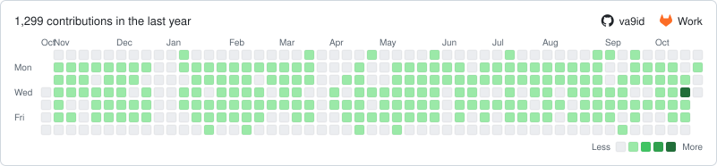

# Merge Contributions

Merges your Github contributions with your Gitlab contributions into a single contribution graph like so:

<!-- merge-contributions:start -->
<picture>
  <source media="(prefers-color-scheme: dark)" srcset="contributions-dark.svg">
  
</picture>
<!-- merge-contributions:end -->

## Usage

### Automatic workflow

Nightly [Github Action](.github/workflows/contribution-graph.yml) regenerates the graph and commits it back to this README automatically. You only need to set the `GITLAB_USERNAME` secret in the repo settings.

### Manual

Run the script with your usernames:

```sh
python3 merge_contributions.py --github GITHUB_USERNAME --gitlab GITLAB_USERNAME --readme README.md
```

Set the `GITHUB_TOKEN` env variable for exact counts, otherwise the data is scraped from the public profile.
